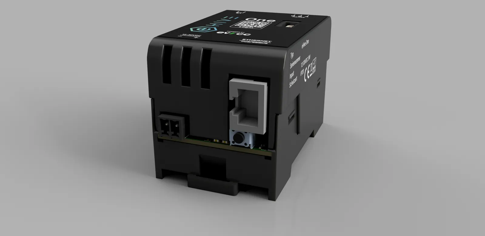

# LEDs & Taster

## NetMode‑Taster

- Position: **unterhalb der RJ45‑Buchse**.
- Du nutzt ihn für Netzwerk‑ und Passwort‑Recovery (`5 s` DHCP / `10 s` Default‑IP).
- Hinweis: NetMode setzt bei beiden Aktionen die Zugangspasswörter zurück und startet das Gerät neu.

Details siehe *Software → NetMode (Netzwerk‑Taster)*.

## NetMode‑LED

Die rote NetMode‑LED unterhalb der RJ45‑Buchse signalisiert den Netzwerk‑Recovery‑Modus:

- **Taster unter 5 s gehalten:** LED leuchtet dauerhaft.
- **Taster 5 s bis unter 10 s gehalten:** LED aus.
- **Taster ab 10 s gehalten:** LED blinkt schnell.

Nach abgeschlossenem Start zeigt die LED den aktiven Netzwerkmodus an:

- **DHCP:** LED blinkt.
- **Default‑IP:** LED leuchtet dauerhaft.

## System‑LED

- Farbe und Position: **grün, nahe USB‑C**.
- **Normalbetrieb:** weiches Atmen mit etwa zwei Sekunden Periodendauer.
- **Hohe CPU-Last:** Sind alle vier CPU-Kerne mindestens drei Sekunden lang zu mindestens 80 % ausgelastet, blinkt die LED im Sekundentakt. Sobald mindestens ein Kern zehn Sekunden lang unter 60 % liegt, wechselt sie zurück zum Atmen.
- **Reboot nach NetMode:** Die LED leuchtet dauerhaft; der Ablauf dauert ca. 1 Minute.

### USB-Konfiguration

Bei der Konfiguration über einen Stick mit dem Label `EHIVE` oder `EHIVE_BACKUP` zeigt die System-LED zusätzliche Muster:

| LED-Muster | Bedeutung |
| --- | --- |
| 3 × kurz, Pause; insgesamt dreimal | Netzwerkkonfiguration erfolgreich übernommen und geprüft |
| 5 × schnell | Netzwerkkonfiguration fehlgeschlagen |
| 2 × kurz | Diagnose-Logging auf dem USB-Stick gestartet |

Nach dem Signalmuster kehrt die LED in den normalen Betriebszustand zurück. Für alle Einzelheiten und die Kontrolle über `status.conf` siehe [USB-Konfiguration für die Werkstatt](../software/usb-konfiguration.md).

## DI‑LED (EnWG §14a)

- Zeigt den Status des digitalen Eingangs (DI) an.

Hintergrund (allgemein): §14a EnWG beschreibt die netzorientierte Steuerung bestimmter Verbrauchseinrichtungen. Informationen dazu z. B. über Bundesnetzagentur/gesetzliche Grundlagen.
