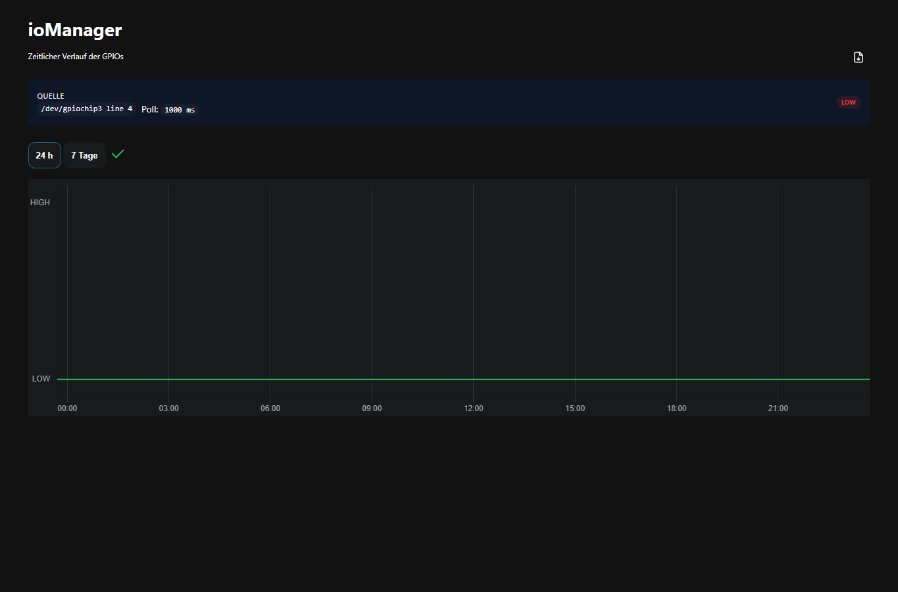

# ioManager

ioManager zeigt den aktuellen Zustand und den Verlauf der Digitaleingänge **DI1** und **DI2**. Beide Eingänge lassen sich unabhängig überwachen und über eine HTTP-Schnittstelle auslesen.

Typische Anwendungen sind Relaiskontakte, Betriebs- und Störmeldungen sowie externe Steuersignale. Anschlusshinweise stehen unter [Digitale Eingänge](../hardware/connectors.md#digitale-eingange-di1-und-di2).

## Zugriff

1. SmartHub öffnen.
2. **ioManager** in der App-Liste auswählen.
3. Falls die App fehlt, im SmartHub App Store installieren oder aktualisieren.

## DI1 und DI2 abfragen

Auf demselben eHive:

```text
http://localhost:3000/api/gpio
```

Beispielantwort, wenn nur DI2 aktiv ist:

```json
{"value":false,"di1":false,"di2":true}
```

| Feld | Bedeutung |
|---|---|
| `value` | DI1; bleibt für bestehende Abfragen unverändert |
| `di1` | Zustand von DI1 |
| `di2` | Zustand von DI2 |

`true` bedeutet aktiv, `false` bedeutet inaktiv. **Bestehende Abfragen mit `.value` funktionieren weiterhin für DI1.**

### DI2 gezielt auswählen

```text
http://localhost:3000/api/gpio?input=di2
```

Bei dieser Abfrage enthält `value` den Zustand von DI2:

```json
{"value":true,"di1":false,"di2":true}
```

`input=di1` wählt DI1. Die Felder `di1` und `di2` enthalten unabhängig von der Auswahl weiterhin beide Eingangszustände. Ein eigener Endpunkt nur für DI2 ist nicht erforderlich. Ungültige Eingangsauswahlen liefern HTTP 400.

### Zugriff aus dem Netzwerk

Über den SmartHub-Proxy:

```text
http://<IP-ADRESSE>/apps/ioManager/api/gpio
http://<IP-ADRESSE>/apps/ioManager/api/gpio?input=di2
```

Groß-/Kleinschreibung bei `ioManager` beachten. `localhost` bezeichnet immer das Gerät, auf dem die Abfrage ausgeführt wird. Port 3000 ist für lokale Anwendungen auf dem eHive vorgesehen.

### Weitere Schnittstellen

| Abfrage | Rückgabe |
|---|---|
| `/api/status` | Zustände als 0/1, Eingangsdetails und Antwortzeitstempel |
| `/api/status?input=di2` | DI2 zusätzlich im Feld `value` |
| `/api/trend?range=24h&input=di2` | Verlauf von DI2 |
| `/api/export.csv?range=24h&input=di2` | Verlauf von DI2 als CSV |

Für die Verlaufs- und Exportabfragen kann `input=di1` verwendet werden. Ohne Auswahl wird DI1 abgefragt. Als Zeitraum stehen `24h` und `7d` zur Verfügung.

## evcc HEMS

Wenn evcc auf demselben eHive läuft, kann ein Eingang als HEMS-Limit eingebunden werden.

### DI1: bestehende Konfiguration

```yaml
type: relay
maxpower: 4000
limit:
  source: http
  uri: http://localhost:3000/api/gpio
  jq: .value
```

### DI2

Für DI2 in derselben Konfiguration den Filter ändern:

```yaml
limit:
  source: http
  uri: http://localhost:3000/api/gpio
  jq: .di2
```

Alternativ lässt sich DI2 über die URL auswählen und der bisherige Filter beibehalten:

```yaml
limit:
  source: http
  uri: http://localhost:3000/api/gpio?input=di2
  jq: .value
```

Die beiden DI2-Beispiele zeigen den jeweiligen `limit`-Abschnitt. `type` und `maxpower` bleiben wie im vollständigen DI1-Beispiel bestehen. `maxpower` muss zur Anlage und zum vorgesehenen Steuersignal passen.

## Anzeige und Verlauf

- DI1 und DI2 getrennt auf HIGH/LOW prüfen.
- Den gewünschten Eingang und Zeitraum für den Verlauf auswählen.
- Bei Bedarf den Verlauf des ausgewählten Eingangs als CSV exportieren.

Die Eingänge werden im konfigurierten Pollingintervall eingelesen. Das Installationspaket verwendet eine Sekunde; bei Updates bleibt die vorhandene Einstellung erhalten. Schnelle Impulse werden nicht garantiert erfasst. Verlaufsänderungen werden gepuffert gespeichert; bei einem Neustart können die letzten fünf Minuten fehlen.

## Prüfung nach dem Update

1. Beide Kontakte öffnen: DI1 und DI2 müssen inaktiv sein.
2. Nur DI1 schließen: `di1` und `value` müssen `true`, `di2` muss `false` sein.
3. Nur DI2 schließen: `di2` muss `true`, `di1` und die bisherige Abfrage `value` müssen `false` sein.
4. Beide Kontakte schließen: `di1` und `di2` müssen `true` sein.
5. Beide Kontakte wieder öffnen und den inaktiven Zustand prüfen.

Die Angaben zu `value` beziehen sich hier auf `/api/gpio` ohne Eingangsauswahl.

## Fehlerbehebung

- **Antwort enthält nur `value`:** Die installierte App stellt nur die bisherige DI1-Schnittstelle bereit. ioManager im SmartHub aktualisieren.
- **Status bleibt unverändert:** Kontakt, Verdrahtung und Pollingintervall prüfen. Keine externe Spannung an die Eingänge anlegen.
- **HTTP 404 oder „unknown app“:** Proxy-Pfad und Groß-/Kleinschreibung von `ioManager` prüfen.
- **Diagramm ohne Daten:** Eingang und Zeitraum prüfen, Kontakt schalten und Ansicht neu laden.

## Screenshot


